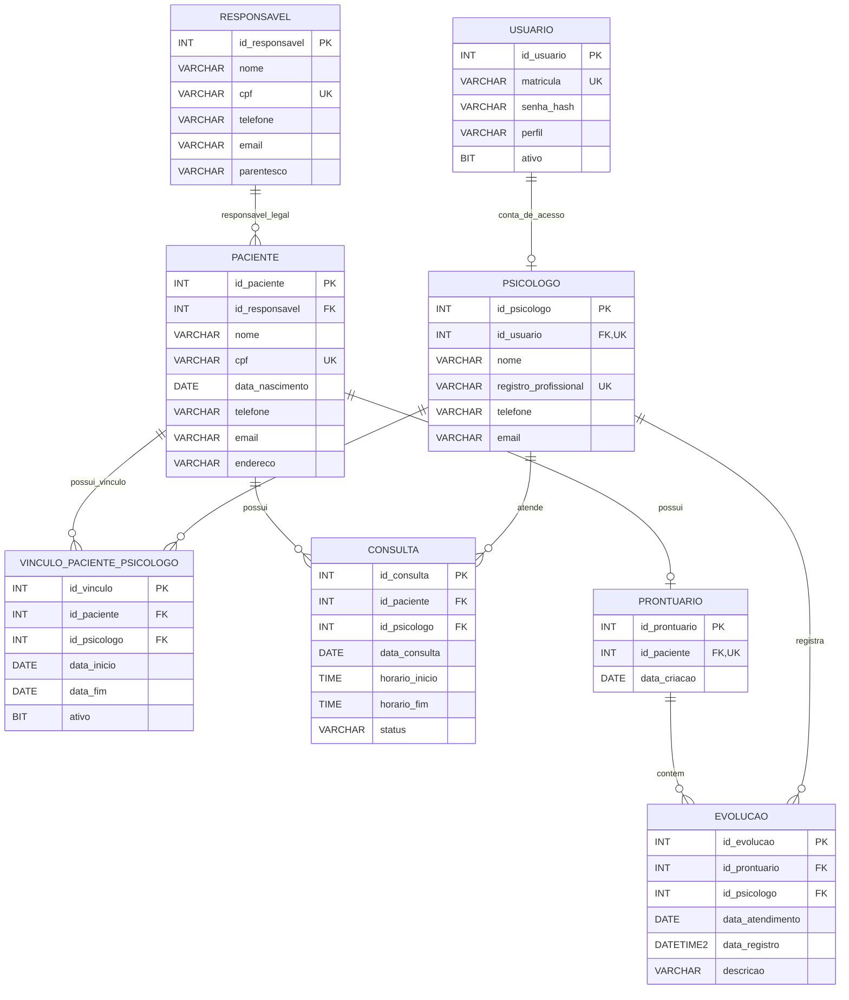

# DER — Clínica Ser Possível

## 1. Apresentação

O Diagrama Entidade-Relacionamento (DER) representa a proposta documental de organização dos dados do sistema da Clínica Ser Possível.

O protótipo acadêmico deste semestre será desenvolvido em linguagem C, com execução pelo terminal e armazenamento local em arquivos `.dat`. O modelo relacional apresentado neste documento serve como referência para a estruturação das informações e não representa uma integração com SQL Server ou outro SGBD nesta entrega.

## 2. Diagrama Entidade-Relacionamento



## 3. Descrição dos relacionamentos

- **RESPONSAVEL e PACIENTE:** cada paciente deve possuir um responsável legal principal cadastrado. Um responsável pode estar associado a um ou mais pacientes.
- **USUARIO e PSICOLOGO:** uma conta de usuário pode estar associada a um cadastro de psicólogo. Cada psicólogo possui uma conta vinculada, conforme as regras de cadastro do sistema.
- **PACIENTE e CONSULTA:** um paciente pode possuir nenhum ou vários agendamentos registrados.
- **PSICOLOGO e CONSULTA:** um psicólogo pode atender nenhuma ou várias consultas registradas.
- **PACIENTE e PRONTUARIO:** um paciente pode possuir zero ou um prontuário. Cada prontuário pertence a um único paciente.
- **PRONTUARIO e EVOLUCAO:** um prontuário pode conter nenhuma ou várias evoluções.
- **PSICOLOGO e EVOLUCAO:** um psicólogo pode registrar nenhuma ou várias evoluções.
- **PACIENTE e VINCULO_PACIENTE_PSICOLOGO:** um paciente pode possuir vários vínculos ao longo do tempo.
- **PSICOLOGO e VINCULO_PACIENTE_PSICOLOGO:** um psicólogo pode possuir vínculos com diferentes pacientes.

## 4. Regras de negócio consideradas

**RN01 — Responsável legal**

Todo paciente cadastrado deverá possuir um responsável legal principal associado ao seu registro, conforme a regra definida para o projeto.

**RN02 — Formação do vínculo profissional**

O primeiro agendamento concluído entre um paciente e um psicólogo estabelece o vínculo profissional entre eles.

A criação do vínculo deverá registrar o paciente, o psicólogo, a data de início e a situação do vínculo.

**RN03 — Histórico de vínculos**

O modelo permite registrar diferentes vínculos ao longo do tempo. O encerramento de um vínculo deverá registrar sua data de término e atualizar sua situação.

**RN04 — Agendamentos**

Os agendamentos deverão registrar paciente, psicólogo, data, horário de início, horário de término e situação.

O sistema deverá considerar regras para evitar conflitos de horários, incluindo sobreposições de consultas, conforme os requisitos definidos.

**RN05 — Prontuário**

Cada paciente poderá possuir um prontuário, com suas evoluções vinculadas ao respectivo registro.

**RN06 — Acesso às informações**

O acesso aos dados e às evoluções deverá respeitar os perfis de usuário e as regras de autorização definidas no projeto, considerando o vínculo profissional e as responsabilidades de cada perfil.

**RN07 — Registro de evoluções**

As evoluções deverão estar associadas ao prontuário e ao psicólogo responsável pelo registro, permitindo identificar a autoria prevista no modelo.

## 5. Legenda

- **PK:** chave primária.
- **FK:** chave estrangeira.
- **UK:** valor único.
- **BIT:** campo lógico.
- **DATE:** data.
- **TIME:** horário.
- **DATETIME2:** data e hora.
- **INT:** número inteiro.
- **VARCHAR:** texto de tamanho variável.

## 6. Observações sobre o modelo

O DER representa uma proposta documental. As restrições de unicidade, obrigatoriedade, integridade referencial e validação dos horários deverão ser detalhadas no modelo lógico e no modelo físico.

A regra de criação do vínculo após a conclusão do primeiro agendamento representa uma regra de negócio. O diagrama, isoladamente, não executa essa operação.

O relacionamento entre consultas e vínculos profissionais também deverá ser considerado na implementação das regras de autorização, principalmente nos casos de encerramento de vínculo ou mudança de psicólogo.

Os dados apresentados são estruturais e não garantem, por si só, segurança, confidencialidade ou conformidade legal.

O protótipo deverá utilizar dados fictícios durante os testes acadêmicos.
```

