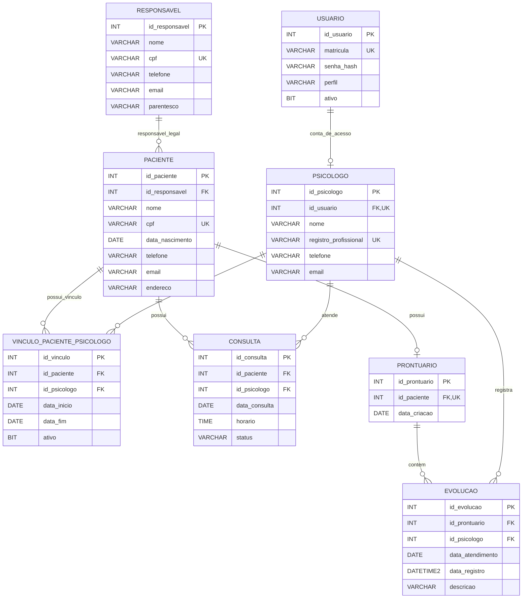

# DER — Clínica Ser Possível

O diagrama representa a proposta documental de banco de dados. O protótipo deste semestre utiliza arquivos `.dat` em C e não se conecta ao SQL Server.

## Legenda

- **PK:** chave primária.
- **FK:** chave estrangeira.
- **UK:** valor único.
- `RESPONSAVEL ||--o{ PACIENTE`: cada paciente referencia um responsável legal principal; um responsável pode estar associado a mais de um paciente.
- `PACIENTE ||--o| PRONTUARIO`: um paciente pode ter zero ou um prontuário; quando criado, o prontuário pertence a um único paciente.
- `VINCULO_PACIENTE_PSICOLOGO` resolve a relação muitos-para-muitos entre pacientes e psicólogos e registra se o vínculo está ativo.
- As restrições de unicidade para impedir horários duplicados e os detalhes de nulidade são definidos no script SQL.
