# DER — Clínica Ser Possível

Diagrama Entidade-Relacionamento do banco de dados proposto para o sistema da clínica.

```mermaid
erDiagram
    USUARIO {
        INT id_usuario PK
        VARCHAR login UK
        VARCHAR senha_hash
        VARCHAR perfil
    }

    PACIENTE {
        INT id_paciente PK
        INT id_usuario FK, UK
        VARCHAR nome
        VARCHAR cpf UK
        DATE data_nascimento
        VARCHAR telefone
        VARCHAR email
        VARCHAR endereco
    }

    PSICOLOGO {
        INT id_psicologo PK
        INT id_usuario FK, UK
        VARCHAR nome
        VARCHAR registro_profissional UK
        VARCHAR telefone
        VARCHAR email
    }

    CONSULTA {
        INT id_consulta PK
        INT id_paciente FK
        INT id_psicologo FK
        DATE data_consulta
        TIME horario
        VARCHAR status
    }

    PRONTUARIO {
        INT id_prontuario PK
        INT id_paciente FK, UK
        DATE data_criacao
    }

    EVOLUCAO {
        INT id_evolucao PK
        INT id_prontuario FK
        INT id_psicologo FK
        DATE data_evolucao
        VARCHAR descricao
    }

    USUARIO ||--o| PACIENTE : possui
    USUARIO ||--o| PSICOLOGO : possui
    PACIENTE ||--o{ CONSULTA : agenda
    PSICOLOGO ||--o{ CONSULTA : realiza
    PACIENTE ||--o| PRONTUARIO : possui
    PRONTUARIO ||--o{ EVOLUCAO : contem
    PSICOLOGO ||--o{ EVOLUCAO : registra
```

## Legenda

- **PK:** chave primária.
- **FK:** chave estrangeira.
- **UK:** campo com restrição de unicidade.
- **1:N:** um registro pode estar relacionado a vários registros.
- **1:1:** relacionamento individual, conforme as restrições definidas.
